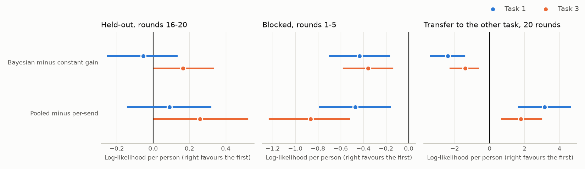

# Learning a Hidden Partner

Akshat Kakade, November 2026. A learning project on computational modelling of behaviour, using public data.

## Summary

Do people learn about a hidden partner, or just which actions pay? And does it matter whether their learning
slows as evidence builds? I fitted four models to a repeated human-AI trust game to find out.

**Fifteen choices per person could not separate these mechanisms.** All four models predicted held-out choices about
as well as a baseline that repeats each person's usual choice. A recovery test explains why: for agents built from real
people's fitted parameters, the pipeline identified learning dynamics at chance (0.51) and generalisation only weakly
(0.60). People mostly showed a stable preferred send plus a small reaction to outcomes. So the main result is a measured limit on
what this kind of data can show, not a winning model.

## Data

The data come from Jayasekara, Deng, Ho and Prissé (2026): 302 participants, 20 rounds per task, between-subjects AI
profiles (Social, Exploratory, Competitive). I used the two tasks where the participant is the trustor. Each round they
send 0 to 10 points from an endowment of 10, the amount is tripled, and the AI returns some of it. In Task 3 the AI also
starts with 10. The tasks were analysed separately. Their order is undocumented.

**The partner.** From the AI's logged draws, the partner is memoryless and reacts only to the current send. From round 2
it defects (returns 0) about 10% of the time, regardless of profile. Otherwise it picks one of four strategies and looks up
a return. Sending 10 pays best on average in every profile. I rebuilt this as a simulator from the observed rules. It
reproduced the AI's full conditional return distributions out of sample (p = 0.19 for Task 1 rules on Task 3, and a
borderline p = 0.054 for the reverse). That validates the partner, not any account of human behaviour.

**Feedback.** The deposit doesn't document what people saw each round, so I used the AI's randomness as a natural
experiment. Behavioural analyses support the assumption that participants had access to information about the preceding
round's outcome before making their next decision. The effect is consistent across both trustor tasks (0.044 points of
send per point of surprise, t = 3.8 and 4.0), while a future-outcome placebo shows no corresponding association. The
reaction is small, and I could not confirm the display from the instructions.

## Models

All four learn the return per point sent, value each send with a risk penalty, and choose with a softmax with stickiness
and a fixed 5% lapse. They differ on two dimensions, and these interact, so this is a structured comparison and not a
clean factorial. Full equations are in `model_spec.md`.

| | Pooled across sends | Separate per send |
|---|---|---|
| **Constant gain** | M1 | M2 (Q-learning) |
| **Bayesian** | M3 (Bayesian linear regression) | M4 |

Each model has four parameters per person (`beta`, `rho`, `tau`, and a gain) and a starting belief `g0` shared across people
within a task. The Bayesian updates are exact under an assumed Normal response model, which is not the true partner.

## Evaluation

Parameters were fitted on rounds 1-15. Rounds 16-20 were scored with parameters frozen and beliefs still updating. Other tests
were an early-rounds block (fit 6-20, score 1-5) and transfer between tasks.

**A disclosed change.** The first fit had no lapse. On that fit, all four models lost to the baseline on mean score, because
a few overconfident fits took huge penalties. I added the lapse after seeing this, so it wasn't part of the original plan.
The raw fits are kept in `results/07_results_report.txt`. The change mattered: before the refit, pooled models appeared to win
in both tasks, and that claim did not survive.

## Results

**Prediction.** Mean log-likelihood over five held-out choices, with the gap to baseline and its 95% bootstrap interval:

| Model | Task 1 | Gap to baseline | Task 3 | Gap to baseline |
|---|---|---|---|---|
| M1 | -4.32 | -0.14 (-0.50, 0.21) | -3.99 | +0.08 (-0.25, 0.39) |
| M2 | -4.42 | -0.23 (-0.59, 0.12) | -4.24 | -0.17 (-0.54, 0.18) |
| M3 | -4.38 | -0.20 (-0.56, 0.15) | -3.82 | +0.25 (-0.03, 0.52) |
| M4 | -4.47 | -0.29 (-0.65, 0.06) | -4.09 | -0.02 (-0.33, 0.28) |
| Baseline | -4.18 | | -4.07 | |

**The two dimensions.** Paired differences, averaged across the other dimension:

| Contrast | Task 1 | Task 3 |
|---|---|---|
| Pooled minus per-send | +0.09 (-0.14, 0.32) | +0.26 (0.01, 0.52) |
| Bayesian minus constant gain | -0.06 (-0.25, 0.13) | +0.16 (0.01, 0.33) |

Neither dimension shows a clear effect. The Task 3 intervals only just clear zero, across many comparisons, and medians are
near zero, so I don't read them as findings.

**Recovery explains the tie.** Agents built from real people's Task 1 fits, 200 per model, 15 rounds:

| True model | M1 | M2 | M3 | M4 |
|---|---|---|---|---|
| M1 | **0.38** | 0.15 | 0.26 | 0.21 |
| M2 | 0.26 | **0.33** | 0.17 | 0.24 |
| M3 | 0.30 | 0.28 | **0.25** | 0.18 |
| M4 | 0.21 | 0.30 | 0.14 | **0.34** |

Chance is 0.25 for this table. Generalisation accuracy was 0.60 and dynamics 0.51, against chance of 0.5, and 39% of agents were
near-tied. These agents resemble people (mean send 4.9 to 5.5 against 5.5 real, repeat rate 0.67 to 0.71 against 0.72). An
earlier recovery with invented, faster-learning agents gave 0.77 and 0.62. So the method works when learning is strong, and
real people don't learn strongly enough here. In the fits, 30% to 56% of people, depending on the model, sit at the no-learning
limit.

**Hypotheses.** H1, that the Bayesian model predicts better, mostly early, is not supported: Bayesian models were worse in
rounds 1-5 (-0.43 and -0.36), and all models lost to the baseline there. H2, that parameters are only coarsely recoverable at
this length, is supported. At 15 rounds and with invented agents, `rho` recovered well (Spearman 0.71 to 0.84), `beta` roughly
and too high (0.62 to 0.68), and the gain (0.42 to 0.53) and `tau` (0.30 to 0.43) poorly. A small check suggested `beta` and `tau`
improve a lot at 100 rounds.

**Secondary results.**

- **Fit against prediction:** per-send models fitted training rounds better (M4 has the best AIC in both tasks) without
  predicting better. Equal parameter counts hid a difference in flexibility.
- **Transfer:** pooled models transferred better across tasks (+3.1 and +1.8) and constant gain beat Bayesian (-2.4 and -1.4),
  but every model stayed below the baseline, so I treat this as exploratory.
- **Profile:** mean send didn't differ by profile. The one effect surviving correction across 32 tests was exploratory: in Task
  1, pooled models found more learning among people facing the Social AI (41% at the no-learning limit, against about 66%
  for Competitive).
- **Strategy anomaly:** the Task 1 strategy-mix wobble (p = 0.005) doesn't survive correction for about 30 tests, isn't
  driven by one strategy, and doesn't change returns.

## Limitations

- Fifteen training choices per person is very few, and recovery shows it's the main constraint.
- The lapse was added after seeing results, and it protects scores without regularising `beta`, which often sits at its limit.
- All models use an assumed Normal response model that misses the zero spike and the U-shaped response, mainly at sends 1 to 3.
- Models are myopic, with no exploration. Bayesian models value actions at the posterior mean, so uncertainty affects
  learning speed but not choice.
- What was on screen, whether profiles were named, and task order are undocumented.
- Results describe this game and this scripted partner, not people in general.

## What I would do next

Pool across people with a hierarchical model, so each person's estimates borrow strength from the group. Add a prior on `beta`.
Above all, design for identifiability: a partner that changes partway through would make constant-gain and Bayesian
learners behave differently, which this stable partner never forces them to do.

## References

- Jayasekara, D. N., Deng, R., Ho, J. Q., & Prissé, B. (2026). Exploring trust in Artificial Intelligence (AI) systems: Insights from a repeated trust game. *Journal of Behavioral and Experimental Economics, 125*, 102658.
- Wilson, R. C., & Collins, A. G. E. (2019). Ten simple rules for the computational modeling of behavioral data. *eLife, 8*, e49547.
